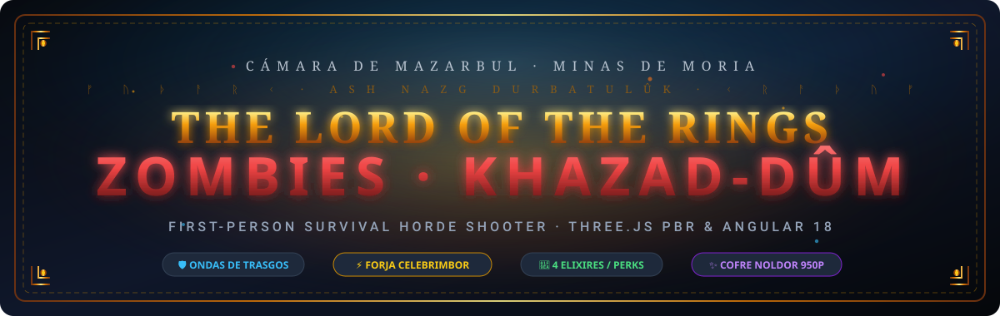
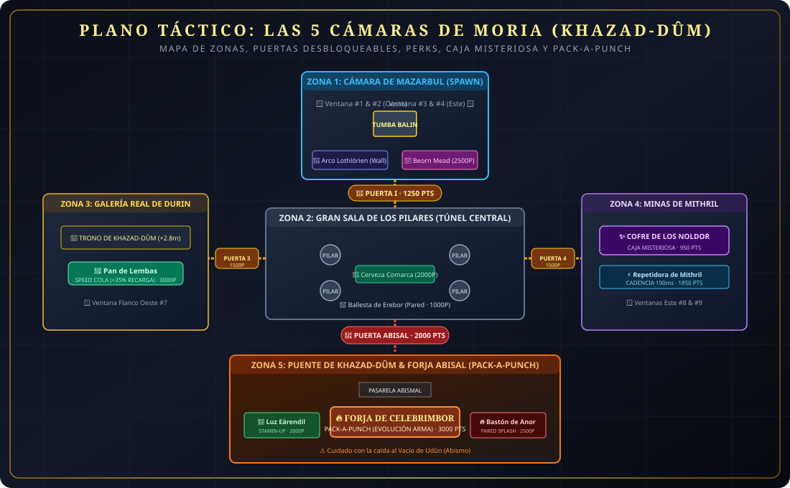
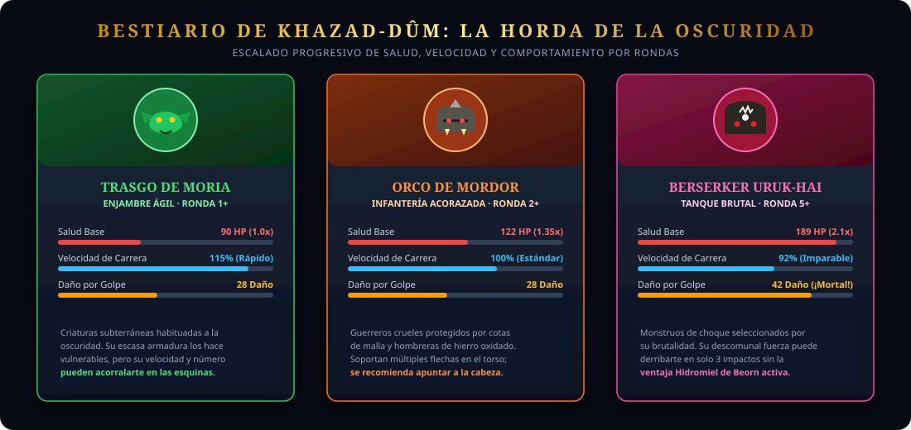
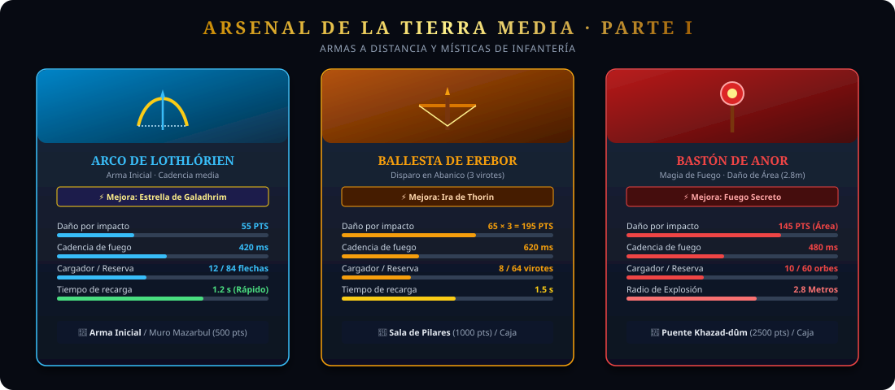
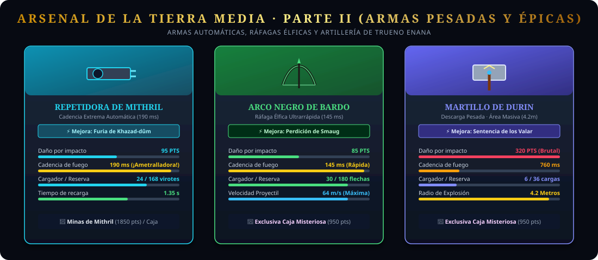
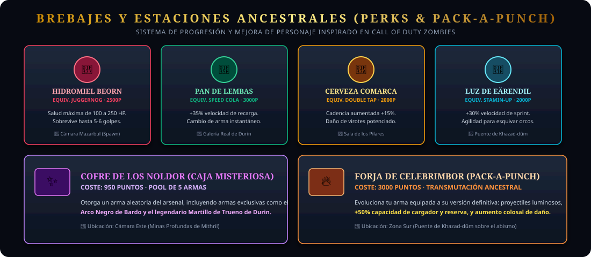

# 🏹 The Lord of the Rings: Zombies of Moria (Khazad-dûm)

<div align="center">



[](https://angular.dev/)
[](https://threejs.org/)
[](https://www.typescriptlang.org/)
[](LICENSE)

*Un shooter en primera persona de supervivencia por oleadas ambientado en las profundidades de Khazad-dûm, fusionando la mitología de **El Señor de los Anillos** con las mecánicas icónicas de **Call of Duty: Zombies** (Kino der Toten / Der Riese).*

[🎮 Características](#-características-principales) • [🗺️ Mapa y Zonas](#️-mapa-táctico-las-5-cámaras-de-moria) • [👹 Bestiario](#-bestiario-de-la-oscuridad) • [⚔️ Arsenal](#️-arsenal-de-la-tierra-media) • [🧪 Perks y Forja](#-brebajes-y-estaciones-míticas) • [🕹️ Controles](#️-guía-de-controles) • [🚀 Instalación](#-instalación-y-ejecución)

---

</div>

## 📖 Prólogo

> *"Tambores, tambores en lo profundo... No podemos salir. Una sombra se mueve en la oscuridad. Ya vienen."*  
> — *Libro de Mazarbul*

Has quedado atrapado junto a la **Tumba de Balin** en la Cámara de Mazarbul. Las hordas subterráneas de Moria han olido la sangre y se abalanzan a través de las ventanas tapiadas. Tu única salvación es resistir ronda tras ronda, administrar tus puntos, reconstruir barricadas, comprar armas forjadas en tiempos antiguos, beber elixires ancestrales y desvelar los secretos de la **Forja de Celebrimbor**.

---

## 🎮 Características Principales

- **Motor Gráfico PBR 3D con Three.js:** Texturas en alta resolución con mapas normales, de rugosidad, iluminación volumétrica de antorchas dinámicas y niebla atmosférica.
- **Mecánicas Clásicas de CoD Zombies:**
  - Sistema de **rondas progresivas** con incremento escalado de dificultad.
  - **Reparación de barricadas** con tablones de madera (+10 pts por tablón, máx. 50 pts/ronda).
  - **Economía de puntos:** +10 por impacto, +60 por baja normal, +100 por tiro a la cabeza (*headshot crítico*).
  - **Caja Misteriosa (*Cofre de los Noldor*):** 950 puntos para obtener armas legendarias exclusivas.
  - **Pack-a-Punch (*Forja de Celebrimbor*):** 3000 puntos para transmutar tu arma activa, duplicando su letalidad e imbuyéndola con proyectiles rúnicos.
  - **Power-Ups aleatorios al caer enemigos:** *Luz Blanca de Gandalf (Insta-Kill)*, *Doble Puntuación* y *Munición Máxima*.
  - **Mira de precisión (ADS):** Apuntado con botón derecho para mayor precisión y zoom de cámara.

---

## 🗺️ Mapa Táctico: Las 5 Cámaras de Moria

El mapa es un complejo subterráneo interconectado con **5 zonas explorables**, barreras de escombros y puertas selladas por runas enanas que requieren puntos para ser abiertas.

<div align="center">



</div>

### Detalle de las 5 Cámaras

| Zona | Nombre | Puntos Clave | Puertas de Acceso |
| :--- | :--- | :--- | :--- |
| **Zona 1** | **Cámara de Mazarbul (Spawn)** | Tumba de Balin, Ventanas 1 a 4, Muro del *Arco de Lothlórien* (500 pts), *Hidromiel de Beorn*. | Punto de inicio |
| **Zona 2** | **Gran Sala de los Pilares** | Columnas colosales octogonales, Muro de la *Ballesta de Erebor* (1000 pts), *Cerveza de la Comarca*. | **Puerta I:** 1.250 pts |
| **Zona 3** | **Galería Real de Durin** | Ala Oeste elevada (+2.8m), Trono de los Reyes Enanos, *Pan de Lembas (Speed Cola)*. | **Puerta 3 (Norte/Sur):** 1.500 pts |
| **Zona 4** | **Minas Profundas de Mithril** | Ala Este, *Cofre de los Noldor (Caja Misteriosa)*, Muro de la *Repetidora de Mithril* (1850 pts). | **Puerta 4 (Norte/Sur):** 1.500 pts |
| **Zona 5** | **Puente Abisal & Forja** | Abismo sobre el fuego de Udûn, *Forja de Celebrimbor (Pack-a-Punch)*, *Luz de Eärendil*, *Bastón de Anor*. | **Puerta Abisal:** 2.000 pts |

---

## 👹 Bestiario de la Oscuridad

A medida que avanzan las rondas, la composición de la horda cambia introduciendo tipos de enemigos más resistentes, letales y con blindaje de hierro.

<div align="center">



</div>

### Estadísticas de los Enemigos

```
HP de Ronda = [90 + (Ronda - 1) × 45] × Multiplicador de Tipo
```

1. **Trasgo de Moria (`goblin`):**
   - **Multiplicador HP:** `1.0x` (Base)
   - **Velocidad:** `+15%` más rápido que la media.
   - **Daño:** `28 HP` por impacto.
   - **Estrategia:** Aparecen desde la Ronda 1. Son ágiles y trepan las barricadas sin dudar. Debes evitar que te arrinconen en pasillos estrechos.
2. **Orco de Mordor (`orc`):**
   - **Multiplicador HP:** `1.35x` (Acorazado)
   - **Velocidad:** Velocidad estándar de persecución.
   - **Daño:** `28 HP` por impacto.
   - **Estrategia:** Aparecen a partir de la Ronda 2. Portan cimitarras y hombreras con púas. Los disparos al pecho se mitigan; busca disparos limpios a la cabeza.
3. **Berserker Uruk-hai (`uruk`):**
   - **Multiplicador HP:** `2.1x` (Tanque pesado)
   - **Velocidad:** Carga pesada constante.
   - **Daño:** `42 HP` por zarpazo (**¡Letal!** Puede abatirte en 3 golpes si no llevas *Hidromiel de Beorn*).
   - **Estrategia:** Irrumpen a partir de la Ronda 5. Gran tamaño y armadura completa de placas negras de Isengard.

---

## ⚔️ Arsenal de la Tierra Media

Cada arma cuenta con una variante estándar y una forma transmutada legendaria a través de la **Forja de Celebrimbor (Pack-a-Punch)** por 3.000 puntos. Al evolucionar, el arma obtiene un **+50% de munición y cargador**, proyectiles imbuidos con luz élfica/arcana y un aumento colosal de daño.

### Armas Ligeras y Místicas

<div align="center">



</div>

### Armas Pesadas, Automáticas y de Artillería

<div align="center">



</div>

### Tabla Comparativa del Arsenal

| Arma | Versión Mejorada | Tipo de Disparo | Daño Base | Cadencia | Cargador / Reserva | Obtención |
| :--- | :--- | :--- | :---: | :---: | :---: | :--- |
| **Arco de Lothlórien** | *Estrella de Galadhrim* | Flecha de luz recta | **55** | 420 ms | 12 / 84 | **Inicial** / Muro (500 pts) |
| **Ballesta de Erebor** | *Ira de Thorin* | Abanico de 3 virotes | **65 × 3 (195)** | 620 ms | 8 / 64 | Muro Zona 2 (1.000 pts) |
| **Bastón de Anor** | *Fuego Secreto* | Orbe mágico explosivo | **145** (Área 2.8m) | 480 ms | 10 / 60 | Muro Zona 5 (2.500 pts) |
| **Repetidora de Mithril** | *Furia de Khazad-dûm* | Ráfaga automática continua | **95** | 190 ms | 24 / 168 | Muro Zona 4 (1.850 pts) |
| **Arco Negro de Bardo** | *Perdición de Smaug* | Saeta élfica ultrarrápida | **85** | 145 ms | 30 / 180 | **Cofre de los Noldor** (950 pts) |
| **Martillo de Durin** | *Sentencia de los Valar* | Descarga sísmica en área | **320** (Área 4.2m) | 760 ms | 6 / 36 | **Cofre de los Noldor** (950 pts) |

---

## 🧪 Brebajes y Estaciones Míticas

<div align="center">



</div>

### Brebajes de la Tierra Media (Perks)

| Brebaje | Equivalente CoD | Coste | Efecto | Ubicación |
| :--- | :--- | :---: | :--- | :--- |
| 🍷 **Hidromiel de Beorn** | *Juggernog* | **2.500 pts** | Aumenta la salud máxima de **100 a 250 HP**. Permite aguantar hasta 5-6 golpes. | Cámara de Mazarbul (Spawn) |
| 🍞 **Pan de Lembas** | *Speed Cola* | **3.000 pts** | Incrementa un **+35% la velocidad de recarga** y cambio entre armas secundarias. | Galería Real de Durin |
| 🍺 **Cerveza de la Comarca** | *Double Tap* | **2.000 pts** | Aumenta la cadencia de fuego y la potencia de penetración de los proyectiles. | Gran Sala de los Pilares |
| 🌟 **Luz de Eärendil** | *Stamin-Up* | **2.000 pts** | Concede un **+30% de velocidad de movimiento y sprint prolongado** para evitar emboscadas. | Puente de Khazad-dûm |

### Estaciones Especiales

- **Cofre de los Noldor (Caja Misteriosa — 950 pts):** Abre un cofre élfico arcano que sortea aleatoriamente un arma del catálogo. Es la única forma de conseguir el letal *Arco Negro de Bardo* o el demoledor *Martillo de Durin*.
- **Forja de Celebrimbor (Pack-a-Punch — 3.000 pts):** Ubicada sobre el puente suspendido en el abismo. Sitúa tu arma en el yunque rúnico para elevar su daño, ampliar sus cargadores y otorgar un rastro de proyectil luminoso legendario.

---

## 🕹️ Guía de Controles

| Acción | Tecla / Control | Descripción |
| :--- | :---: | :--- |
| **Moverse** | `W` `A` `S` `D` | Movimiento en primera persona |
| **Mirar / Apuntar** | `Ratón` | Rotación de cámara libre en 360° |
| **Disparar** | `Clic Izquierdo` | Disparo principal (automático si mantienes pulsado) |
| **Apuntar con mira (ADS)** | `Clic Derecho` | Reduce la dispersión y hace zoom táctico |
| **Recargar** | `R` | Recarga el arma activa usando tu reserva |
| **Interactuar / Reparar** | `F` | Reconstruye tablones de barricadas, compra puertas, armas y perks |
| **Cambiar de Arma** | `1` / `2` o `Rueda Ratón` | Alterna entre tus dos ranuras de armamento |
| **Esprintar** | `Shift Izquierdo` | Aumenta temporalmente la velocidad de carrera |
| **Saltar** | `Espacio` | Salto de personaje |
| **Bloquear Ratón** | `Clic en pantalla` | Activa el *PointerLock* para control FPS fluido |
| **Pausa / Menú** | `ESC` | Libera el cursor del ratón |

---

## 🚀 Instalación y Ejecución

### Requisitos Previos

- [Node.js](https://nodejs.org/) (versión 18.x o superior recomendada)
- [npm](https://www.npmjs.com/) (incluido con Node.js)
- Navegador moderno con soporte para **WebGL** (Chrome, Firefox, Edge, Safari, Brave)

### Pasos de Instalación

1. **Clonar el repositorio:**
   ```bash
   git clone https://github.com/guillemrima/lotr-zombis.git
   cd lotr-zombis
   ```

2. **Instalar dependencias:**
   ```bash
   npm install
   ```

3. **Iniciar el servidor de desarrollo:**
   ```bash
   npm start
   # o bien: npx ng serve
   ```

4. **Jugar:**
   Abre tu navegador en [http://localhost:4200/](http://localhost:4200/) y haz clic sobre la pantalla para activar el ratón e iniciar la partida.

### Compilación para Producción

Para compilar el proyecto optimizado para desplegar en GitHub Pages o cualquier servidor web estático:

```bash
npm run build
```

Los artefactos listos para producción se generarán en la carpeta `dist/lotr-zombies/browser`.

---

## 🛠️ Stack Tecnológico

- **Framework:** [Angular 18](https://angular.dev/) (Standalone Components, Signals & Reactive State)
- **Renderizado 3D:** [Three.js](https://threejs.org/) (PBR Materials, Dynamic Lights, Shader/Particle Systems)
- **Audio:** Web Audio API sintético procedural y muestras espaciales en 3D
- **Estilos:** SCSS moderno con diseño responsivo, fuentes cinemáticas e interfaces HUD translúcidas
- **Control de Versiones:** Git & GitHub

---

## 📜 Licencia

Este proyecto está disponible bajo la licencia [MIT](LICENSE).

*Nota: "The Lord of the Rings" y todos los nombres de personajes, lugares y elementos son marcas registradas de Middle-earth Enterprises y los herederos de J.R.R. Tolkien. Este proyecto es una obra no comercial de homenaje creada con fines educativos y de entretenimiento.*
